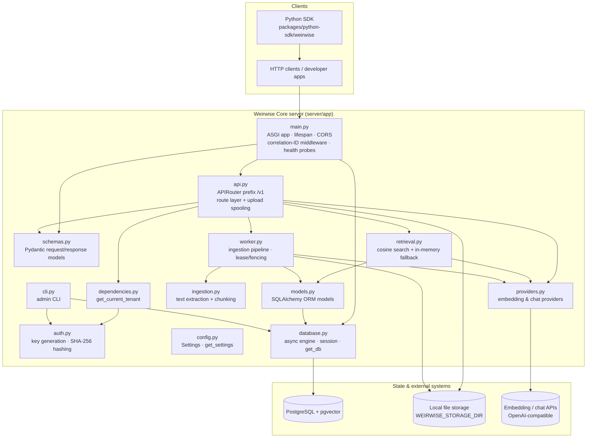
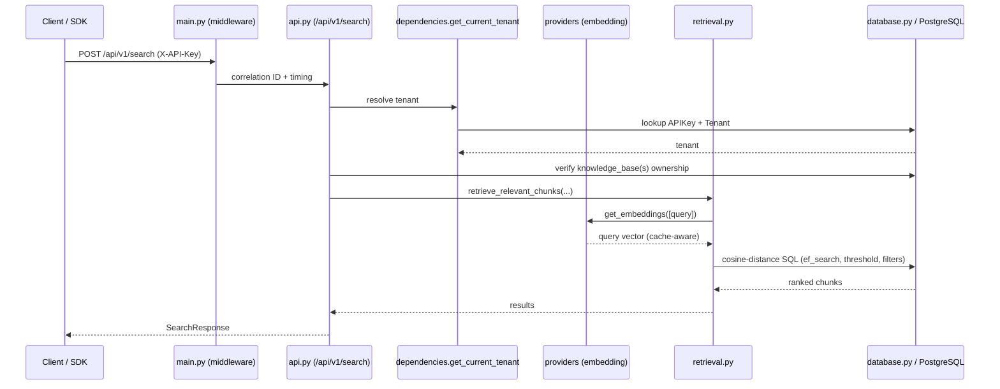

# Weirwise Core Architecture

> **Status**: Current
> **Authority**: This document describes the architecture that is implemented in this repository. The HTTP contract is authoritative in [`CONTRACT.md`](../CONTRACT.md); this document is descriptive and must be updated when modules are added, removed, or re-layered.
> **Last Updated**: 2026-11-10

Weirwise Core is an independently reusable RAG infrastructure engine: a FastAPI REST service, an
asynchronous ingestion pipeline, PostgreSQL/pgvector persistence, retrieval and provider adapters,
and a separately distributable typed Python SDK. It has no dependency on any Platform/product
repository and exposes only the public contract in `CONTRACT.md`.

## 1. Scope

This document records the real layering and the responsibility and boundary of each module in
`server/app/`, and the distinct distributable components (SDK, benchmarks, migrations). It does not
restate numerical results (see [`engineering/`](engineering/) and [`../benchmarks/`](../benchmarks/))
or the HTTP endpoint contract (see [`CONTRACT.md`](../CONTRACT.md)).

## 2. Component & layering diagram

The layering is a modular monolith. The HTTP/route layer depends on the authentication dependency,
schemas, retrieval, providers, the worker pipeline and the ORM models; the ORM layer depends on the
async database session; provider and ingestion helpers are leaf modules with no API dependency. There
are no circular dependencies between these modules.

## 3. Server module responsibilities and boundaries

| Module | Responsibility | Boundary / does not own |
|---|---|---|
| `server/app/main.py` | Builds the `FastAPI` app (title/description/version from settings), registers CORS (`allow_credentials=False`), the correlation-ID + timing middleware, and the health probes; the `lifespan` context ensures the storage directory exists, creates the `vector` extension on PostgreSQL, and runs `Base.metadata.create_all`; mounts the v1 router under `/api`. | Does not implement business endpoints, retrieval, or ingestion logic. |
| `server/app/api.py` | The HTTP route layer for `/api/v1`: knowledge bases, documents (upload/list/get/delete), search, assistants, chat, and conversation messages. Owns request validation, tenant-scoped resource ownership checks, streaming upload spooling with a hard size cap and signature/UTF-8 validation, SHA-256 deduplication, and dispatch to inline background ingestion or the worker. | Does not implement retrieval scoring, chunking, or provider transport. |
| `server/app/dependencies.py` | `get_current_tenant` FastAPI dependency: reads `X-API-Key`, hashes it, resolves an active `APIKey` and active `Tenant`, and raises `401`/`403`. | No key generation (that is `auth.py`) and no route logic. |
| `server/app/auth.py` | Pure helpers: `generate_api_key` (secure random key with a prefix) and `hash_api_key` (SHA-256 hex digest). | Not a FastAPI dependency; performs no persistence. |
| `server/app/schemas.py` | Pydantic request/response models and error schemas; defines field validation (e.g. `top_k` bounds, `score_threshold` range, query target validation). This is the serialization/validation boundary of the HTTP API. | No persistence and no business logic. |
| `server/app/config.py` | `Settings` (`pydantic-settings`, `WEIRWISE_` prefix, repository-anchored `.env`), fail-fast field/cross-field validation, and the `get_settings` cache. | Not imported for behavior beyond configuration access. |
| `server/app/database.py` | Async engine and `async_sessionmaker` construction, pool vs `NullPool` selection, per-statement `statement_timeout` on PostgreSQL, the `get_db` session dependency, and the declarative `Base`. | No ORM models (declared in `models.py`). |
| `server/app/models.py` | SQLAlchemy ORM models (`tenants`, `api_keys`, `knowledge_bases`, `documents`, `document_chunks`, `assistants`, `conversations`, `messages`, `ingestion_jobs`) and cross-dialect column types (`GUID`, `CompatibleJSON`) plus the pgvector `Vector(1536)` column. | No query logic. |
| `server/app/ingestion.py` | Pure text extraction for PDF (`pypdf`), DOCX (`python-docx`, including tables), CSV (`csv` reader with `header: value` formatting), and UTF-8 text/Markdown, plus `chunk_text` paragraph/sentence chunking with overlap. | No I/O orchestration, no embedding calls, no persistence. |
| `server/app/providers.py` | Provider abstractions (`EmbeddingProvider`, `ChatProvider` ABCs) and the OpenAI-compatible implementations `OpenAIEmbeddingProvider` / `OpenAIChatProvider`; retry/backoff for transient failures; the shared query-embedding cache; per-event-loop pooled HTTP clients. See [`PROVIDERS_AND_STORAGE.md`](PROVIDERS_AND_STORAGE.md). | Does not persist vectors or decide retrieval. |
| `server/app/retrieval.py` | Retrieval engine: embeds the query once, then scores chunks with native pgvector cosine distance (tenant- and knowledge-base-scoped, optional threshold and JSONB metadata filter, deterministic ordering) or an in-memory cosine fallback for non-PostgreSQL test engines. See [`RETRIEVAL_AND_INDEXING.md`](RETRIEVAL_AND_INDEXING.md). | Does not extract text or write chunks. |
| `server/app/worker.py` | Executes the ingestion pipeline: claims/leases jobs with a fencing token and heartbeat, extracts text, chunks, generates embeddings into a disk-backed memmap, and performs an atomic chunk replacement guarded by ownership; also reclaims stale jobs and runs the polling worker loop. | Does not serve HTTP. |
| `server/app/cli.py` | Administrative CLI (`admin create-tenant`, `check-db`) exposed as the `weirwise` console script: creates tenants/API keys and diagnoses database connectivity and the pgvector extension. | No HTTP serving. |

## 4. Request lifecycle (search)

## 5. Distinct distributable components

| Component | Location | Role |
|---|---|---|
| Server package | `server/` (`weirwise-core`, `weirwise` console script) | The API service, worker, CLI, and Alembic migrations. |
| Python SDK | `packages/python-sdk/` (`weirwise`) | A standalone, typed synchronous client for the public HTTP API. Treated as a separate distribution with its own tests and packaging. See [`SDK_AND_RELEASE.md`](SDK_AND_RELEASE.md). |
| Migrations | `server/alembic/` + `server/alembic/versions/` | Schema evolution, executed via `alembic -c server/alembic.ini upgrade head` against an explicitly selected database. |
| Benchmarks | `benchmarks/` (`retrieval_benchmark.py`, `load_benchmark.py`, `soak_test.py`) | Standalone measurement scripts; not imported by the service. See [`PERFORMANCE_AND_RELIABILITY.md`](PERFORMANCE_AND_RELIABILITY.md). |
| Examples | `examples/basic_rag.py` | End-to-end usage example driven by the SDK. |
| Auxiliary script | `scripts/verify_phase3_workflow.py` | A workflow verification script; not part of the packaged distributions (excluded by `[tool.setuptools.packages.find]`). |

## 6. Public contract

The HTTP surface is defined by [`CONTRACT.md`](../CONTRACT.md) and generated FastAPI/OpenAPI
metadata. Tight changes to routes, request/response fields, authentication, or error codes are
compatibility-sensitive; intentional contract changes must be documented and tested (see the
compatibility rules in [`CONTRACT.md`](../CONTRACT.md) and the conventions in
[`SDK_AND_RELEASE.md`](SDK_AND_RELEASE.md)).

## 7. Standards alignment

- **Modular architecture**: business logic (`retrieval.py`, `ingestion.py`), infrastructure
  (`providers.py`, `database.py`), persistence (`models.py`), API (`api.py`, `main.py`), and
  integrations (provider adapters) are separated with defined boundaries and no circular
  dependencies.
- **Depend on abstractions**: retrieval and the worker depend on the `EmbeddingProvider` /
  `ChatProvider` interfaces rather than a concrete provider; provider and storage configuration is
  documented in [`PROVIDERS_AND_STORAGE.md`](PROVIDERS_AND_STORAGE.md).
- **Testing levels**: unit, integration, REST/SDK contract, end-to-end, and regression coverage are
  described in [`TESTING.md`](TESTING.md).
